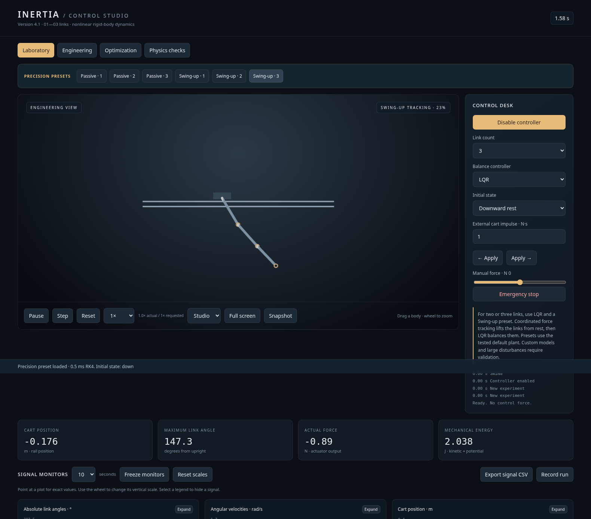
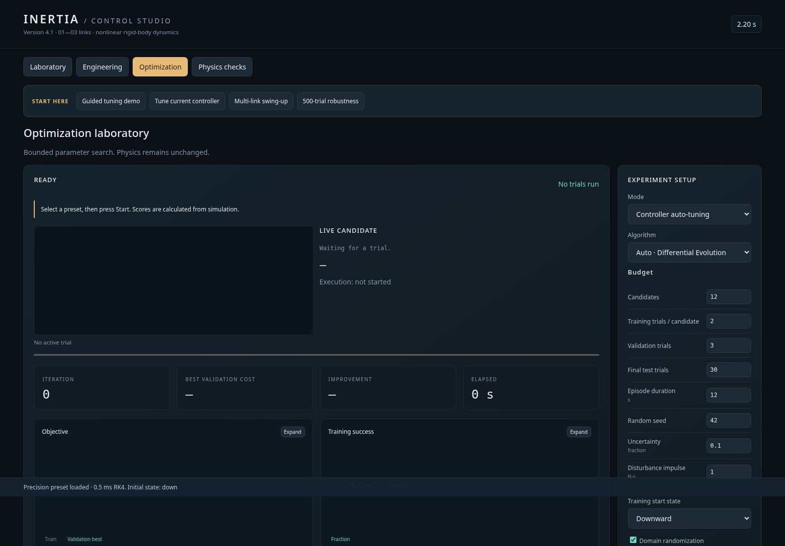

<div align="center">

# INERTIA

### Control Studio · Interactive Dynamics & Feedback Laboratory

**A complete cart–pendulum control laboratory in a single HTML file.**  
Explore nonlinear mechanics, swing-up, balancing, optimization, and numerical validation for **1–3 coupled links**.

   

[**Run from source**](#-quick-start) · [**Explore the controls**](#-features) · [**Read test results**](docs/VALIDATION.md) · [**Deployment guide**](docs/PUBLISHING.md)



<sub>Inertia laboratory shown in a headless browser. Rendering uses the 2D fallback in this capture; a suitable GPU enables the Three.js 3D scene.</sub>

</div>

---

## ✦ What is Inertia?

Inertia is an **interactive, physics-based engineering demonstrator** for a translating cart carrying one, two, or three serial pendulum links. It was developed to make nonlinear system dynamics and feedback control observable, testable, and tunable through a practical engineering dashboard.

Unlike a scripted animation, the motion is calculated from numerical integration of the physical model. The interface lets you change plant parameters, apply disturbances, observe response curves, compare controllers, and run constrained optimization experiments.

The simulation is **self-contained**: no sign-in, cloud backend, API key, CDN, or external package installation is required to use the built demo.

## ✦ Features

| Laboratory | Engineering | Optimization | Physics checks |
| --- | --- | --- | --- |
| Interactive cart–pendulum simulation | Adjustable masses and geometry | Differential Evolution / random search | Energy conservation and decay |
| One, two, or three links | Motor and friction parameters | Training, validation, and unseen tests | Euler–Lagrange cross-checks |
| LQR, PID and fuzzy controllers | Sensor noise and delay | Domain randomization | RK4 convergence evidence |
| Nominal multi-link swing-up presets | Save/load model JSON | Pause/resume checkpoints | Force and slew bounds |
| Live plots, CSV export, snapshots | Actuator limits and rail contacts | Physical-data calibration workflow | Synthetic calibration checks |



## ⚡ Quick start

**No installation:** download the repository, then open [`index.html`](index.html) in a current desktop browser. This is the built standalone application, with its rendering library already embedded.

For an HTTP development server:

```bash
python start_server.py
```

Then open `http://127.0.0.1:8000/`.

To work on the source:

```bash
python build.py       # regenerate index.html
npm ci                # install optional test dependencies (Node.js 22.22.2+ or 24.15+)
npm test              # run source and interface regression tests
npm run test:demo     # run guided optimization workflow test
npm run validate      # seeded numerical and robustness report
```

## 🧭 Suggested experiments

1. Choose **Passive · 3** to inspect damped multibody motion with the controller off.
2. Choose **Swing-up · 1** to see a single-link energy-based swing-up demonstration.
3. Choose **Swing-up · 2** or **Swing-up · 3** for nominal planned-force swing-up followed by LQR balancing.
4. Open **Engineering** to change a mass, motor limit, or friction coefficient, and observe the response.
5. Open **Optimization**, choose the guided tuning preset, and compare the baseline against the tuned result.

For multi-link swing-up, the documented successful operating envelope applies to the **default** physical model, not arbitrary user-modified plants.

## 📊 Evidence and reproducibility

| Recorded study | Result |
| --- | --- |
| Default 2-link randomized trials | **20/20** successful under the specified 5% uncertainty test |
| Default 3-link randomized trials | **20/20** successful under the specified 5% uncertainty test |
| Default 2-link nominal capture | ~6.001 s |
| Default 3-link nominal capture | ~7.001 s |
| Guided optimization demo | 0/20 → 12/20 successful in a deliberately weak baseline scenario |

These are **simulation results**, not hardware qualifications or a promise of success for other parameters. The reports provide seeds, conditions, and additional details.

[Read the verification methodology and limits](docs/VALIDATION.md) · [View the full engineering guide](docs/ENGINEERING_GUIDE.md)

## 🧱 Project layout

```text
index.html               Ready-to-open standalone demo
src/                     Physics engine, controls, optimizer, UI and rendering
vendor/                  Offline Three.js distribution and MIT notice
tests/                   Numerical, regression and interface tests
reports/                 Reproducible simulation outcomes
tools/                   Optional Python trajectory optimization utilities
docs/                    Engineering guide, architecture and evidence
.github/workflows/       CI verification and GitHub Pages deployment
build.py                 Standalone HTML builder
```

The repository includes **Windows and macOS/Linux publishing scripts** for creating a new public GitHub demo repository. See the [publishing guide](docs/PUBLISHING.md).

The precomputed swing-up references are included. **CasADi and SciPy are not needed to run the demo.** They are required only if you choose to regenerate the trajectory references.

## ⚠️ Modeling scope

Inertia models planar rigid-body motion with lumped motor dynamics, simplified sensing, damping, friction and discrete rail impacts. It does **not** model flexible rods, electrical motor dynamics, thermal behavior, backlash or real-world hardware uncertainty in full detail. Measured hardware calibration has **not** been validated.

The UI is optimized for desktop use; it includes responsive layout rules, but performance and GPU rendering depend on browser and hardware.

## 📖 Documentation

- [Architecture and source map](docs/ARCHITECTURE.md)
- [Full engineering guide](docs/ENGINEERING_GUIDE.md)
- [Validation and test limits](docs/VALIDATION.md)
- [GitHub Pages deployment](docs/PUBLISHING.md)
- [Third-party notices](THIRD_PARTY_NOTICES.md)

---

<div align="center">

**Designed and developed by Mehdi Moallemkolaei**  
*Nonlinear mechanics · control engineering · numerical simulation · reproducible experiments*

</div>
