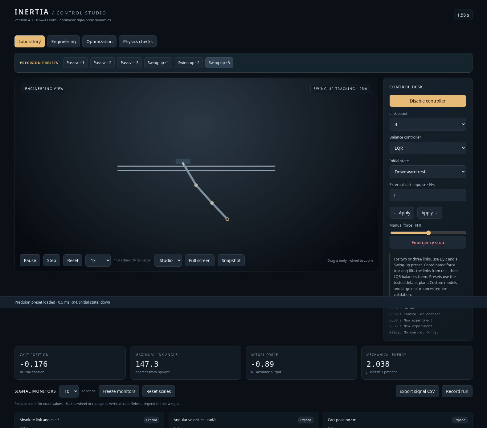

# Inertia Control Studio

**A nonlinear cart–pendulum laboratory for one, two, or three links.** Try a swing-up, apply a disturbance, or change a plant parameter and compare the response.

[**Launch the laboratory**](https://ace-alch.github.io/apps/inertia-lab/) · [Engineering guide](docs/ENGINEERING_GUIDE.md) · [Validation reports](docs/VALIDATION.md)

<a href="https://ace-alch.github.io/apps/inertia-lab/"></a>

*The screenshot shows the 2D renderer. Browsers with suitable WebGL support can use the 3D scene.*

## Choose an experiment

| Experiment | What you can change and observe |
| --- | --- |
| **Swing-up and balance** | Select one to three links and inspect the capture into upright balance. |
| **Compare feedback** | Tune LQR, PID, or fuzzy control and inspect the live response plots. |
| **Stress the plant** | Vary mass, friction, actuator limits, noise, or delay. Apply a disturbance, then export the trace. |
| **Tune a controller** | Run optimization and compare baseline and tuned performance on held-out trials. |

## Run the laboratory locally

**No installation:** download the repository, then open [`index.html`](index.html) in a current desktop browser. This is the built standalone application, with its rendering library already embedded.

For an HTTP development server:

```bash
python start_server.py
```

Then open `http://127.0.0.1:8000/`.

To work on the source:

```bash
python build.py       # regenerate index.html
npm ci                # install optional test dependencies (Node.js 22.22.2+ or 24.15+)
npm test              # run source and interface regression tests
npm run test:demo     # run guided optimization workflow test
npm run validate      # seeded numerical and robustness report
```

## Try these experiments

1. Choose **Passive · 3** to inspect damped multibody motion with the controller off.
2. Choose **Swing-up · 1** to see a single-link energy-based swing-up demonstration.
3. Choose **Swing-up · 2** or **Swing-up · 3** for nominal planned-force swing-up followed by LQR balancing.
4. Open **Engineering** to change a mass, motor limit, or friction coefficient, and observe the response.
5. Open **Optimization**, choose the guided tuning preset, and compare the baseline against the tuned result.

For multi-link swing-up, the documented successful operating envelope applies to the **default** physical model, not arbitrary user-modified plants.

## Recorded simulation results

| Recorded study | Result |
| --- | --- |
| Default 2-link randomized trials | **20/20** successful under the specified 5% uncertainty test |
| Default 3-link randomized trials | **20/20** successful under the specified 5% uncertainty test |
| Default 2-link nominal capture | ~6.001 s |
| Default 3-link nominal capture | ~7.001 s |
| Guided optimization demo | 0/20 → 12/20 successful in a deliberately weak baseline scenario |

These are **simulation results**, not hardware qualifications or a promise of success for other parameters. The reports provide seeds, conditions, and additional details.

[Read the verification methodology and limits](docs/VALIDATION.md) · [View the full engineering guide](docs/ENGINEERING_GUIDE.md)

## How it is built

The browser integrates the planar rigid-body model with simplified sensing, friction, motor dynamics, and rail impacts. The standalone HTML includes its renderer and swing-up references. Download it for offline use. Optional trajectory regeneration uses CasADi and SciPy.

[Architecture and source map](docs/ARCHITECTURE.md) · [Repository case study](portfolio/DESIGN.md) · [Deployment guide](docs/PUBLISHING.md) · [Third-party notices](THIRD_PARTY_NOTICES.md) · [License](LICENSE)

Designed and developed by **Mehdi Moallemkolaei**.
