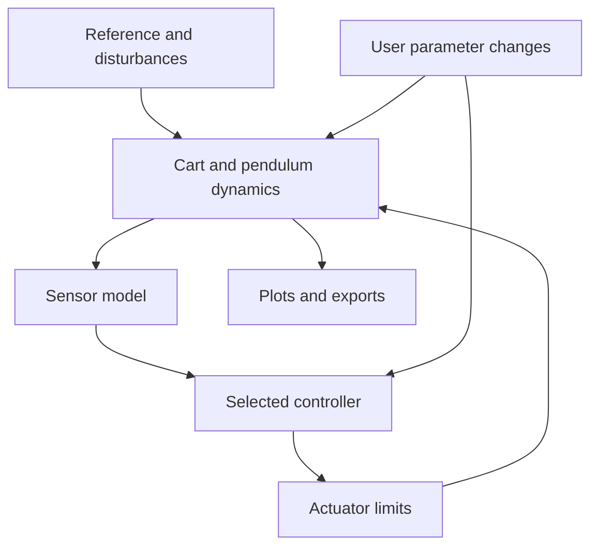

# Inertia Control Studio / Pendulum Lab: design record

## Purpose

Explore one-, two- and three-link cart-pendulum dynamics, swing-up, balancing and tuning.

## Elements

| Element | Documentation boundary |
| :-- | :-- |
| Plant dynamics | Included in the stated project scope. Implementation details need the corresponding source or design file. |
| Sensor model | Included in the stated project scope. Implementation details need the corresponding source or design file. |
| Controller | Included in the stated project scope. Implementation details need the corresponding source or design file. |
| Actuator constraints | Included in the stated project scope. Implementation details need the corresponding source or design file. |
| Visualization | Included in the stated project scope. Implementation details need the corresponding source or design file. |

## Technical stack

- JavaScript
- Browser
- Control
- Numerical simulation

## Boundaries

The repository has a standalone HTML build, source, tests and recorded simulation reports. Existing numerical results apply to the stated model and trials. They do not establish measured hardware performance. Existing engineering and validation guides remain the main technical references.

## Decisions to recover

Record each design decision with its problem, selected option, rejected options and supporting artifact. Keep the original model or source revision with the record.

## Feedback structure

The existing source separates the physics core, optimization, display, scene and presets. Use the engineering guide for the exact model. Simulation reports are preserved in `reports/`. Numerical checks and randomized trials have their own conditions and seeds.

The built `index.html` includes its runtime assets. Optional development and validation dependencies are distinct from the files needed to open the demo.
